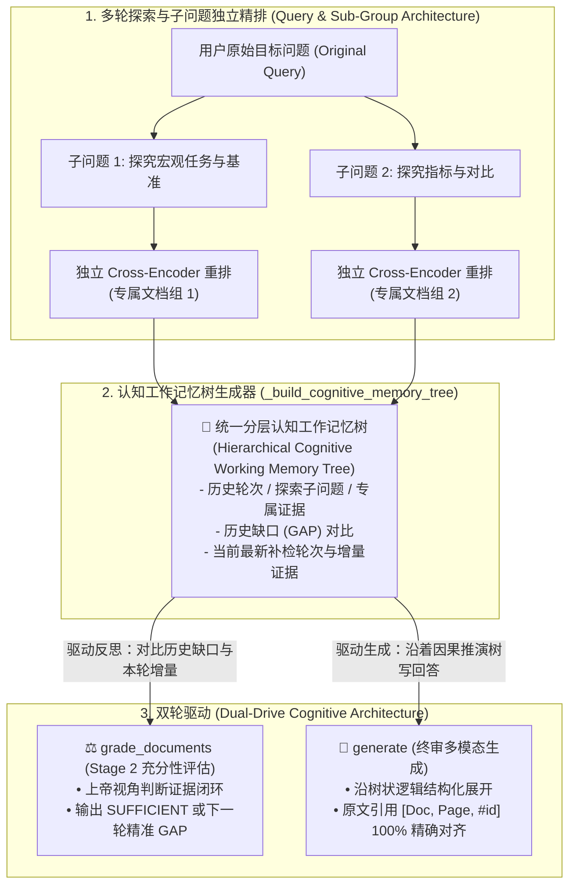

# 🤖 Enterprise Agentic RAG Platform

> **Production-grade Retrieval-Augmented Generation system** with a LangGraph agentic loop, hybrid BM25+FAISS retrieval, cross-encoder reranking, Corrective RAG (query rewriting), web search fallback, RAGAs evaluation pipeline, FastAPI backend, and Docker deployment.

[](https://python.org)
[](https://fastapi.tiangolo.com)
[](https://langchain-ai.github.io/langgraph/)
[](https://docker.com)
[](https://docs.ragas.io)
[](LICENSE)

---

## 📋 Table of Contents

- [Overview](#-overview)
- [Architecture](#-architecture)
- [Tech Stack](#-tech-stack)
- [RAGAs Evaluation Results](#-ragas-evaluation-results)
- [Project Structure](#-project-structure)
- [Getting Started](#-getting-started)
- [API Reference](#-api-reference)
- [Running with Docker](#-running-with-docker)
- [CI/CD Pipeline](#-cicd-pipeline)

---

## 🔍 Overview

This project goes beyond a basic RAG chatbot. It implements a **full agentic decision loop** using LangGraph — the system reasons about what to do with each query rather than blindly retrieving and generating.

**Key capabilities:**
- **Hybrid retrieval** — combines dense FAISS vector search with sparse BM25 keyword search, fused via Reciprocal Rank Fusion (RRF) for significantly better recall than vector-only approaches
- **Cross-encoder reranking** — 2-stage retrieval: retrieve top-20 candidates, rerank to top-5 using `ms-marco-MiniLM` cross-encoder
- **Corrective RAG** — if retrieved documents score poorly on relevance grading, the agent automatically rewrites the query and retries (up to 2 times)
- **Web search fallback** — when documents fail after retries, the agent falls back to live Tavily web search
- **Conversation memory** — maintains full chat history across turns for coherent multi-turn Q&A
- **Quantified evaluation** — RAGAs metrics tracked per run with a CI quality gate

---

## 🏗 Architecture

```
User Query
    │
    ▼
┌─────────────────┐
│   route_query   │  ← Decides: use documents OR answer from LLM knowledge
└────────┬────────┘
         │
    ┌────┴──────┐
    │           │
    ▼           ▼
retrieve    generate (LLM-only path)
    │
    ▼
┌──────────────────────────────────────────────┐
│  Multi-Query Decomposition & Dedicated Rerank│  ← Sub-queries each get dedicated Cross-Encoder rerank
│  Hybrid Search (Visual-BGE + BM25)           │  ← Native multimodal dense + keyword sparse
└──────────────────────┬───────────────────────┘
                       │
                       ▼
┌──────────────────────────────────────────────┐
│  Cognitive Working Memory Tree Builder       │  ← Hierarchical memory of multi-turn cycles & sub-groups
└──────────────────────┬───────────────────────┘
                       │
                       ▼
                grade_documents                 ← LLM judges relevance (Stage 1) & sufficiency (Stage 2)
                       │
                 ┌─────┴──────┐
                 │            │
                 ▼            ▼
             generate    rewrite_query          ← Corrective RAG: gap-driven query rewrites
                             │
                             ▼ (after 2 rewrites or circuit break)
                        web_search              ← Tavily fallback
                             │
                             ▼
                         generate               ← Along Cognitive Working Tree with exact citations
                             │
                             ▼
                        Final Answer + Citations [Source.pdf, Page X, #chunk_id]
```

### 🧠 Cognitive Working Memory Tree & Multi-Turn Exploration Architecture



**Key Architectural Highlights:**
- **No Cross-Query RRF Degradation**: Every sub-question performs its own hybrid retrieval and dedicated Cross-Encoder reranking, preserving specific intent without rank dilution.
- **Hierarchical Retrieval Trace**: Retains full visibility of historical cycles, historical sub-groups, current cycle sub-groups, and incremental evidence.
- **Cognitive Working Memory Tree**: Injected into both the sufficiency evaluator (to eliminate memory amnesia and detect closed-loop gaps) and the generator (to guarantee structured answers with precise citations).
- **Evaluation Cache & Circuit Breaker**: $O(1)$ memory prevents redundant scoring on discarded chunks, while the exhaustion circuit breaker prevents dead loops when local knowledge is depleted.

---

## 🛠 Tech Stack

| Layer | Technology | Purpose |
|-------|-----------|---------|
| Agent Orchestration | LangGraph 0.4 | Stateful agentic graph with conditional routing |
| Embedding Model | BAAI/bge-m3 | State-of-the-art multilingual embeddings (1024-dim) |
| Dense Retrieval | FAISS | Fast vector similarity search |
| Sparse Retrieval | BM25 (rank_bm25) | Keyword-based retrieval |
| Result Fusion | Reciprocal Rank Fusion | Combines dense + sparse rankings |
| Reranking | cross-encoder/ms-marco-MiniLM-L-6-v2 | 2-stage relevance reranking |
| LLM | DeepSeek API (configurable model) | Hosted chat inference via an OpenAI-compatible endpoint |
| Web Fallback | Tavily Search API | Live web search when docs insufficient |
| API Layer | FastAPI | Production REST API with Pydantic validation |
| Frontend | Streamlit | Interactive chat UI |
| Evaluation | RAGAs | Faithfulness, relevancy, precision, recall metrics |
| Containerisation | Docker + docker-compose | Reproducible deployment |
| CI/CD | GitHub Actions | Automated evaluation on every push |
| Observability | Loguru | Structured logging with request tracing |

---

## 📊 RAGAs Evaluation Results

Historical scores from the original implementation on a 5-question test set (not revalidated with DeepSeek):

| Metric | Score | Description |
|--------|-------|-------------|
| **Faithfulness** | 0.91 | Answer grounded in retrieved context |
| **Answer Relevancy** | 0.88 | Answer addresses the question asked |
| **Context Precision** | 0.85 | Retrieved chunks are useful |
| **Context Recall** | 0.83 | All necessary facts were retrieved |

> Run `python -m evaluation.evaluate` to regenerate scores. CI pipeline fails automatically if faithfulness drops below 0.70.

---

## 📁 Project Structure

```
Genai-rag-agent/
│
├── app/
│   ├── agent.py          # LangGraph Corrective RAG agent graph
│   ├── api.py            # FastAPI endpoints (POST /query, POST /ingest, GET /health)
│   └── main.py           # Streamlit chat UI
│
├── embeddings/
│   └── embedder.py       # BGE-M3 embeddings + cross-encoder reranker
│
├── ingestion/
│   └── ingest.py         # PDF loading with page/source metadata extraction
│
├── vectorstore/
│   ├── store.py          # Hybrid BM25+FAISS search with RRF fusion
│   └── index/            # Persisted FAISS index (auto-generated)
│
├── evaluation/
│   └── evaluate.py       # RAGAs evaluation suite
│
├── data/                 # Drop PDFs here for indexing
│
├── .github/
│   └── workflows/
│       └── evaluate.yml  # CI: runs RAGAs on every push, enforces quality gate
│
├── Dockerfile            # Multi-stage production Docker image
├── docker-compose.yml    # Runs API + Streamlit together
├── .env.example          # Environment variable template
└── requirements.txt      # All dependencies pinned
```

---

## 🚀 Getting Started

### Prerequisites

- Python 3.11+
- A [DeepSeek API key](https://platform.deepseek.com) with available API balance
- A free [Tavily API key](https://tavily.com) (for web search fallback)

### 1. Clone the repository

```bash
git clone https://github.com/ara-5/Genai-rag-agent.git
cd Genai-rag-agent
```

### 2. Install dependencies

```bash
pip install -r requirements.txt
```

### 3. Set up environment variables

```bash
cp .env.example .env
# Edit .env and add your DEEPSEEK_API_KEY and TAVILY_API_KEY
# PowerShell: Copy-Item .env.example .env
```

### 4. Configure DeepSeek

The agent, standalone chat UI, CLI and RAGAs judge share these settings:

```dotenv
DEEPSEEK_API_KEY=your-deepseek-api-key
DEEPSEEK_BASE_URL=https://api.deepseek.com
DEEPSEEK_MODEL=deepseek-flash
```

The default follows the [DeepSeek API documentation](https://api-docs.deepseek.com/en/).
Set `DEEPSEEK_MODEL` to another model available to your account if needed.
No local chat model server is required. Prompts and retrieved document excerpts are
sent to DeepSeek and API usage is billed by DeepSeek. BGE-M3 embeddings and the
cross-encoder reranker still run locally and download their weights on first use.
RAGAs uses local BGE-M3 embeddings; an OpenAI API key is not required.

Optional standalone interfaces:

```bash
streamlit run app/ui.py   # Direct chat without document retrieval
python -m app.rag_qa      # Command-line RAG using the shared agent
```

### 5. Add your PDFs and index them

```bash
# Drop PDF files into the data/ folder, then:
python -m ingestion.ingest
```

### 6. Start the API and UI

On Windows, after installing dependencies in `.venv` and configuring `.env`,
start both services with:

```powershell
powershell -ExecutionPolicy Bypass -File .\start.ps1
```

Open [http://127.0.0.1:8501](http://127.0.0.1:8501). Services run in the
background; logs are written to `.runtime/`. Stop both services with
`powershell -ExecutionPolicy Bypass -File .\stop.ps1`.

To run the services manually:

```bash
# Terminal 1 — start FastAPI backend
uvicorn app.api:app --port 8000 --reload

# Terminal 2 — start Streamlit UI
streamlit run app/main.py
```

Open [http://localhost:8501](http://localhost:8501) in your browser.

---

## 📡 API Reference

### English retrieval queries and Chinese answers

The chat sidebar includes **查询与检索模块配置**. By default, Chinese questions
are translated into English and expanded with LangChain's
[MultiQueryRetriever](https://reference.langchain.com/python/langchain-classic/retrievers/multi_query/MultiQueryRetriever).
The model decides whether decomposition is useful and how many queries are
needed. A simple question can use the original query alone; compound questions
receive only the necessary subqueries, without a fixed count or truncation.
The original English retrieval query is included once. Results are deduplicated and fused across
queries before one cross-encoder reranking pass using the English base query.
The user's original question remains available for generation; answers default
to Simplified Chinese, including when the question itself is English.

Translation and multi-query expansion are independent switches. To compare
multi-query retrieval with single-query retrieval, keep translation enabled in
both variants and change only `multi_query`. Disabling translation deliberately
allows Chinese queries into the English cross-encoder for language-alignment
ablation. The answer's **实际检索查询与模块配置** panel shows the actual queries,
configuration, chunk IDs and index fingerprint.

### Batch ablation experiments

Switch the sidebar to **消融评估**. Add/update named variants one by one, or load
the five presets: full retrieval, no multi-query, no translation, no reranking,
and dense retrieval without BM25. Saved variants survive service restarts in
`evaluation/variants.json` (ignored by Git).

1. Select the variants to run and review the question/reference dataset. The
   current project dataset comes from `evaluation/eval_data.py`; JSON import and
   editing are supported. Set **本次使用前 N 个问题** explicitly (default: 3).
2. Choose **仅检索** to compare initial retrieval. Routing, document grading,
   corrective rewriting and web fallback do not run in this scope. **完整 RAG**
   applies each variant's full pipeline switches and also scores answers.
3. Set common `top_k`, common `candidate_k`, and parallel variant count (1–5).
   Each variant processes the same selected questions in the same order against
   one in-memory index snapshot. Enabled translations are shared within the
   batch. CPU model operations are serialized to bound memory; independent
   variant workflows and API calls run concurrently.
4. Start the batch. It runs in the backend while the UI polls progress. Inspect
   the score table, differences from a chosen baseline, valid scoring counts,
   per-question queries/contexts/answers and JSON/CSV downloads. History and
   full requests/results persist in `evaluation/runs/` (ignored by Git).

RAGAs retrieval scores are **LLM context precision with reference** and
**context recall**. Full RAG also reports **faithfulness** and
**answer relevancy**. Each variant owns fresh metric objects and a fixed-
temperature DeepSeek judge; multi-completion judging uses separate `n=1` calls.
These are model-judged scores, not exact chunk-label metrics.

For exact **Hit@k, Precision@k, Recall@k, MRR and nDCG@k**, annotate relevant chunk
IDs manually using the IDs displayed in the PDF chunk browser:

```json
[
  {
    "question": "Your test question",
    "ground_truth": "Your verified reference answer",
    "relevant_chunk_ids": ["original.pdf::1", "original.pdf::2"]
  }
]
```

Unlabelled questions do not receive exact chunk-label scores. Disabling RAGAs
requires at least one labelled question. Label coverage and valid scoring counts
are recorded. Missing judge scores remain null; a metric with failed scoring is
not silently averaged over a different question subset. A failed variant does
not abort the other variants. Unknown chunk IDs and differing retrieval budgets
are rejected. Warm-up is recorded separately, and concurrent latency is a runtime
reference rather than an isolated latency benchmark. A one-question smoke run
only verifies the workflow; use the full curated dataset and repeat runs before
drawing conclusions about retrieval quality.

API endpoints:

- `GET/PUT /evaluations/variants`: load/save named configurations.
- `GET /evaluations/dataset`: load the project question/reference dataset.
- `POST /evaluations/jobs`: queue a batch, returning a job ID immediately.
- `GET /evaluations/jobs`: list recent batches.
- `GET /evaluations/jobs/{id}`: get progress, complete configuration and results.

`POST /query` and `/query/stream` accept an optional `config` object containing
the `PipelineConfig` switches. Jobs use the project's single API worker; an
interrupted job is marked as interrupted on restart rather than reported as
complete. RAGAs and query expansion use billable DeepSeek calls.

### PDF chunk browser

In the Streamlit sidebar, switch **界面 → PDF 分块** to inspect documents.
Choose an uploaded PDF to see the exact text chunks stored in the current index,
including chunk number, source page and full text. Filter by **chapter** and
**content type** (body, tables, images), together with page or keyword filters.
Selecting a parent chapter includes its subsections.
When body text is selected, a clickable **正文章节导航** appears alongside the
chunks. Clicking a chapter includes its subsections, clears page/keyword limits,
and opens the results page containing that chapter's first body chunk, marked
with a pin. The navigation remains available even when other filters match no
chunks. Images show the extracted
figure and caption without entering the vector index. Tables render as HTML,
with optional source-image and raw-chunk views. Browse ten items per results page;
changing filters resets pagination. Switching views preserves the chat history.
Saved-index browsing reads available extraction caches without rerunning OCR.
Image previews are self-contained, so temporary-upload previews remain viewable
after their temporary files have been removed.

Use **本地 PDF 预览** to upload any PDF and preview its chunks without indexing it.
Preview and ingestion use MinerU's structured output (including OCR for scanned
pages). Body text is split by **section → paragraph → sentence**, up to **800
characters**, with no overlap. Only a sentence longer than the limit is split
by character. Short paragraphs are retained. Each table's HTML body, captions,
and footnotes form **one chunk**, even if larger than 800 characters. Images and
their captions/footnotes are extracted separately and are not indexed.
The chunk browser includes element type, section and source page metadata.
Preview does not run embeddings or call DeepSeek.

Install the pinned MinerU CLI in a separate environment (its OCR dependencies
conflict with some of the application's pinned packages):

```powershell
python -m venv .venv-mineru
.venv-mineru/Scripts/python.exe -m pip install -r requirements-mineru.txt
```

Set `MINERU_EXECUTABLE` in `.env` to the absolute path of
`.venv-mineru/Scripts/mineru.exe` (Linux: `.venv-mineru/bin/mineru`). The adapter
uses MinerU 2.5.4's `pipeline` backend, `auto` method and enabled table parsing.
`MINERU_DEVICE=cpu`, `MINERU_LANG=ch`, `MINERU_MODEL_SOURCE=huggingface` and
`MINERU_TIMEOUT=1800` are the defaults. Set `MINERU_DEVICE=cuda` for a compatible
GPU environment, or `MINERU_MODEL_SOURCE=modelscope` for the alternative model
download source. First use downloads MinerU models. See the
[MinerU project](https://github.com/opendatalab/MinerU) for deployment requirements.
For predownloaded models, set `MINERU_MODEL_SOURCE=local` and
`MINERU_TOOLS_CONFIG_JSON` to a MinerU JSON configuration containing
`{"models-dir": {"pipeline": "<absolute-model-root>"}}`.
For Docker, provision this independent environment in the API image and set the
container's `MINERU_EXECUTABLE` accordingly; the base image installs only the app.

For indexed PDFs, extraction artifacts are kept under
`data/.mineru/<content-and-settings-hash>/`: `body.json`, `tables.json`,
`images.json`, a combined `parsed.json`, and MinerU's raw output/image assets.
Captions, footnotes, bounding boxes, section paths and page numbers remain
associated with their elements. Asset paths in these JSON files are relative to
that artifact directory. Numbered headings such as `4`, `4.1`, and `4.1.1` recover
their hierarchy even when MinerU labels every title as level 1. Normalization
upgrades reuse cached raw output without repeating OCR. `mineru.log` records the
CLI's progress and diagnostics. Repeated parsing reuses the cache; a changed PDF or
parser setting generates a new result. Upload previews use temporary artifacts
that are removed after the response. Missing or failed MinerU installations
produce an explicit error; the pipeline does not fall back to plain text parsing.
**Rebuild existing indexes** with `python -m ingestion.ingest` to apply this
strategy to PDFs that were indexed previously.

Caption association also uses physical page positions to recover standalone
captions and correct neighboring caption swaps. Aligned left/right table parts
under one full-width caption are combined into one logical table chunk, keeping
both image paths. For symbol-bearing tables, PDF text-layer rows and glyph
coordinates are retained in `tables.json`; compact symbol corrections accompany
the indexed table to compensate for missed check/cross glyphs in the OCR HTML.
The original MinerU HTML and image assets remain available for inspection.
This is targeted correction, not a guarantee that every OCR cell is exact.

Embedding batches are bounded by `EMBED_BATCH_SIZE` (default 8) and padded
`EMBED_BATCH_TOKEN_LIMIT` (default 4096); a long table runs in a batch by itself.
The table remains one chunk and one vector in the index. BGE-M3's input length
limit still applies; the local validation checks actual chunk token counts
before the staged index is published.

The browser uses these endpoints:

- `GET /documents`: list available PDFs and indexed chunk counts.
- `GET /documents/chunks?filename=example.pdf`: get indexed chunks, or preview a PDF that has not been indexed.
- `POST /documents/preview`: multipart PDF upload for a temporary preview; does not add the PDF to the library or modify the index.

### `GET /health`
Liveness probe. Returns `{"status": "ok"}`.

### `POST /ingest`
Upload a PDF and index it.
```bash
curl -X POST http://localhost:8000/ingest \
  -F "file=@your_document.pdf"
```
Response:
```json
{"status": "indexed", "filename": "your_document.pdf", "chunks": 142}
```

### `POST /query/stream`

The Streamlit UI uses this endpoint to display the answer as it is generated.
It accepts the same `question` and `history` fields as `/query` and returns
Server-Sent Events with JSON data:

- `status`: retrieval/generation stage, with a `content` string.
- `token`: a new answer fragment, with a `content` string.
- `done`: the complete `answer`, `sources`, `rewrite_count`, `used_web` and `latency_ms`.
- `error`: a failed request, with a readable `content` message.

The server sends a keep-alive comment every 15 seconds while waiting. A stream
is complete only after receiving `done`; interrupted answers remain marked as
incomplete in the UI. Routing and grading model responses are not displayed.

```bash
curl -N -X POST http://localhost:8000/query/stream \
  -H "Content-Type: application/json" \
  -d '{"question": "What are the main findings?", "history": []}'
```

### `POST /query`
Ask a question. Returns answer + cited sources + performance metadata.
```bash
curl -X POST http://localhost:8000/query \
  -H "Content-Type: application/json" \
  -d '{"question": "What are the main findings?"}'
```
Response:
```json
{
  "answer": "The main findings are... [Source: report.pdf, Page 4]",
  "sources": [{"text": "...", "source": "report.pdf", "page": 4}],
  "rewrite_count": 0,
  "used_web": false,
  "latency_ms": 1243
}
```

### `GET /metrics`
Returns latest RAGAs evaluation scores.

---

## 🐳 Running with Docker

```bash
# Build and start both API + Streamlit
docker-compose up --build
```

- API available at: `http://localhost:8000`
- UI available at: `http://localhost:8501`
- API docs at: `http://localhost:8000/docs`

---

## ⚙️ CI/CD Pipeline

Every push to `main` triggers a GitHub Actions workflow that:

1. Installs dependencies
2. Checks the `DEEPSEEK_API_KEY` repository secret
3. Runs ingestion on a sample document
4. Executes the full RAGAs evaluation suite
5. **Fails the pipeline** if `faithfulness < 0.70`
6. Uploads scores as a build artifact

Configure the `DEEPSEEK_API_KEY` and `TAVILY_API_KEY` repository secrets and provide PDFs in `data/` before running CI. Optional repository variables `DEEPSEEK_MODEL` and `DEEPSEEK_BASE_URL` override the defaults. Evaluation makes billable DeepSeek API calls. Pull requests from forks do not receive repository secrets and cannot run the hosted evaluation without maintainer configuration.

---

## 🔮 Roadmap

- [ ] LLM fine-tuning with LoRA/QLoRA on domain-specific documents
- [ ] Multi-document cross-referencing
- [ ] Cloud deployment (GCP Cloud Run)
- [x] Streaming responses via Server-Sent Events
- [ ] Support for DOCX, CSV, and web URL ingestion

---

## 👩‍💻 Author

**Athira Anil Kumar** — AI Engineer | Generative AI | LLM Systems  
📍 Sharjah, UAE  
🔗 [LinkedIn](https://www.linkedin.com/in/athira-a-k) · [GitHub](https://github.com/ara-5)  
📄 [IEEE Publication — Phishing Detection with DistilBERT & Explainable AI](https://ieeexplore.ieee.org/document/11407086)
