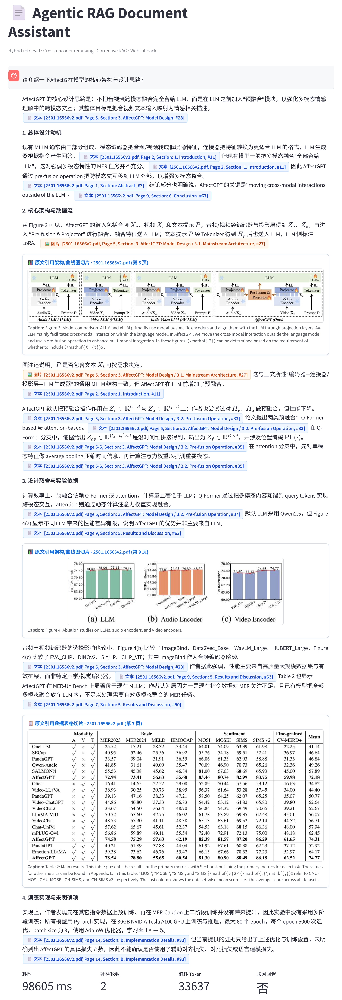
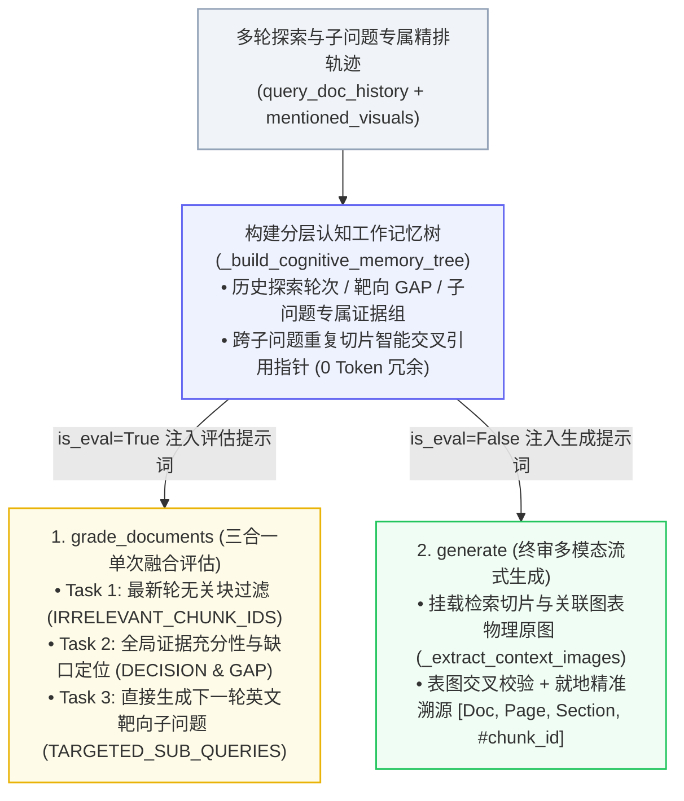
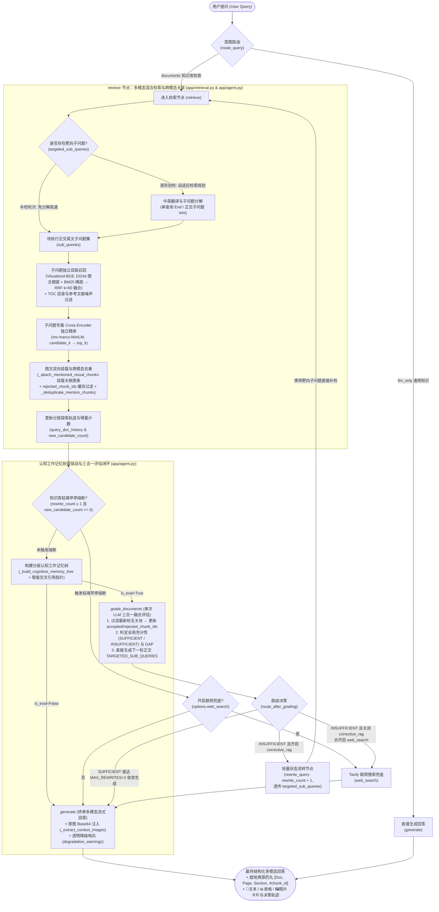
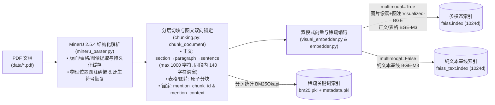

# 🤖 Enterprise Agentic RAG Platform

> **Production-grade Multimodal Agentic RAG system** powered by a LangGraph Cognitive Working Memory Tree, MinerU 2.5.4 structured PDF parsing, dual-index Visualized-BGE + BGE-M3 / BM25 hybrid retrieval, per-sub-question cross-encoder reranking, 3-in-1 Corrective RAG grading with circuit breaker, Tavily web fallback, persistent background-streaming Streamlit UI, and a decoupled RAGAs ablation workbench.

[](https://python.org)
[](https://fastapi.tiangolo.com)
[](https://langchain-ai.github.io/langgraph/)
[](https://github.com/opendatalab/MinerU)
[](https://huggingface.co/BAAI/bge-m3)
[](https://docker.com)
[](https://docs.ragas.io)
[](LICENSE)

---

## ✨ Live Demo — Multimodal Q&A Showcase

以下为系统针对学术论文知识库提问 **「请介绍一下AffectGPT模型的核心架构与设计思路？」** 的真实问答效果（仅展示用户提问与最终多模态图文溯源回答）：



> 📄 **想查看完整的 Agent 多轮反思与溯源细节？**  
> 本次回答共经历 **10 个决策节点（2 轮针对缺口补检）**，装配 12 处高相关多模态证据切片（含 3 处原文架构图/实验图/数据表原图）。点击查阅完整导出报告：  
> 👉 **[查看完整 11 页思考决策链路、Token 分步消耗明细与 12 处原文多模态引用 (PDF)](docs/assets/affectgpt_demo_full.pdf)**

---

## 📋 Table of Contents

- [Live Demo](#-live-demo--multimodal-qa-showcase)
- [Overview](#-overview)
- [Architecture](#-architecture)
- [Tech Stack](#-tech-stack)
- [RAGAs Evaluation Results](#-ragas-evaluation-results)
- [Project Structure](#-project-structure)
- [Getting Started](#-getting-started)
- [Core Features & API Reference](#-api-reference)
- [Running with Docker](#-running-with-docker)
- [CI/CD Pipeline](#-cicd-pipeline)

---

## 🔍 Overview

This project goes far beyond a basic RAG chatbot. It implements a **multimodal agentic cognitive loop** built on LangGraph — parsing PDFs into structured text, tables, and figures, reasoning across multi-turn evidence gaps, cross-checking tables/figures directly with vision-language inputs, and citing every claim to exact chunk IDs.

**Key capabilities:**
- **Structured multimodal ingestion (MinerU 2.5.4)** — extracts clean sections, HTML tables, figures, captions, and native PDF symbols; builds dual FAISS indexes (`faiss.index` with Visualized-BGE pixel+caption embeddings + `faiss_text.index` BGE-M3 text baseline) alongside BM25 sparse search
- **Per-sub-question hybrid retrieval & dedicated reranking** — adaptively plans/decomposes complex queries into orthogonal English sub-questions; each sub-question runs independent dense + BM25 RRF ($k=60$) recall and dedicated `ms-marco-MiniLM` cross-encoder reranking with bidirectional table/figure attachment
- **Cognitive Working Memory Tree & 3-in-1 Corrective RAG** — organizes multi-turn cycles and evidence gaps with Smart Cross-Reference Pointers (0 token redundancy), unifies irrelevance filtering, sufficiency grading, and next-round targeted sub-query planning in a single LLM pass, and enforces an $O(1)$ cache + circuit breaker against dead loops
- **Multimodal grounding & web fallback** — injects retrieved/mentioned figure and table images directly into final generation with inline clickable `📄 文本` / `📊 表格` / `🖼️ 图片` citation pills, transparent degradation warnings, and Tavily web search fallback
- **DeepSeek-style persistent workspace** — timeline-grouped chat sessions (`今天 / 昨天 / 7 天内 / 更早`), background async SSE worker that survives page refreshes and view switching, plus one-click export to Markdown, standalone offline HTML (with KaTeX), and print-to-PDF
- **Decoupled ablation & RAGAs workbench** — 7 preset pipeline variants, a 50-question stratified evaluation dataset (30 simple + 20 complex including cross-paper synthesis), frozen retrieval snapshots, cancellable jobs, and two-stage asynchronous RAGAs scoring

---

## 🏗 Architecture

### 1. 核心认知决策范式 (Core Cognitive Paradigm)

系统核心采用了基于**认知工作记忆树（Cognitive Working Memory Tree）的双驱动决策范式**。多轮检索与探索的所有切片经子问题专属精排并挂载图文关联后，汇聚成统一的分层树状认知结构（`query_doc_history` → `_build_cognitive_memory_tree`），同时驱动后置的**三合一融合评估**与**终审多模态回答**：



* **多轮检索与子问题独立重排轨迹 (`query_doc_history`)**：按探索轮次（`cycle`）、针对缺口（`gap`）及正交子问题分组（`sub_groups`）完整记录每一轮混合召回与 Cross-Encoder 独立精排结果，并通过 `_attach_mentioned_visual_chunks` 自动将正文提及的图表附件挂载至 `mentioned_visuals`，彻底杜绝跨子问题 RRF 相互稀释与图文上下文割裂。
* **分层认知工作记忆树 (`_build_cognitive_memory_tree`)**：将历史轮次、历史信息缺口（GAP）及当前最新轮子问题专属证据组织为因果演进树，并内置**智能交叉引用指针（Smart Cross-Reference Pointer）**——跨子问题或跨轮次重复命中的 `chunk_id` 仅在首次出现时渲染全文，后续位置自动压缩为引用指针（如 `← 亦高度支撑本子问题，详见上方...`），在长探索链中实现 0 Token 冗余与 100% 语义保留。
* **双分支协同驱动**：
  - **分支 1：三合一融合评估 (`grade_documents`, `is_eval=True`)**：在单次 LLM 调用中同时完成「最新轮无关分块剔除 → 全局证据充分性研判与 GAP 定位 → 下一轮英文正交靶向子问题制定」，并结合 `accepted_chunk_ids` / `rejected_chunk_ids` 缓存与**知识库枯竭早停熔断（Circuit Breaker）**避免重复打分与死循环。
  - **分支 2：终审多模态流式生成 (`generate`, `is_eval=False`)**：通过 `_extract_context_images` 将命中及正文关联的表格/图像物理原图转为 Base64 注入多模态请求，要求模型用表格原图交叉校验 OCR 文本并沿认知树逻辑作答，输出带 `📄 文本` / `📊 表格` / `🖼️ 图片` 交互药丸的精确溯源结果。

---

### 2. 端到端系统全流程 (End-to-End LangGraph Pipeline)

从用户提问到精准溯源回答的 LangGraph（`app/agent.py:build_graph`）完整节点与状态转移图：



---

### 3. 离线多模态解析与双索引构建架构 (Offline Multimodal Ingestion & Dual-Index Architecture)

离线入库管线（`ingestion/ingest.py` → `vectorstore/store.py`）将 PDF 文档解析为带双向锚定元数据的多模态切片，并同时构建多模态索引、纯文本基线索引（用于消融对比）与稀疏关键词索引：



**Key Architectural Highlights:**
- **No Cross-Query RRF Degradation**: Every sub-question performs its own hybrid retrieval (`Visualized-BGE` dense + `BM25` sparse with RRF $k=60$) and dedicated Cross-Encoder reranking (`ms-marco-MiniLM-L-6-v2`), preserving specific intent without rank dilution.
- **Bidirectional Cross-Modal Linking & Deduplication**: During ingestion (`chunking.py`) and retrieval (`_attach_mentioned_visual_chunks`), text chunks and `Table`/`Figure` chunks are bidirectionally linked (`mention_chunk_id`, `mention_context`, `mentioned_visuals`), while `_deduplicate_mention_chunks` eliminates redundant text chunks already covered by retrieved visual chunks.
- **Cognitive Working Memory Tree**: Organizes multi-turn cycles, GAP targets, and sub-question groups into one causal structure with Smart Cross-Reference Pointers, jointly driving both single-pass 3-in-1 sufficiency grading and multimodal citation-grounded generation.
- **Single-Pass Evaluation, $O(1)$ Cache & Circuit Breaker**: `grade_documents` unifies irrelevance filtering (`IRRELEVANT_CHUNK_IDS`), sufficiency evaluation (`DECISION` & `GAP`), and next-round sub-query planning (`TARGETED_SUB_QUERIES`) in one LLM call, while `accepted_chunk_ids`/`rejected_chunk_ids` and the `new_candidate_count == 0` circuit breaker prevent redundant scoring and dead loops.
- **Transparent Degradation Sentinel & Multimodal VLM Grounding**: Missing physical images gracefully degrade to caption/text encoding (`visual_embedder.py` / `agent.py`), while VLM failures, circuit breaks, and Tavily web fallbacks emit explicit `degradation_warnings` alongside token breakdowns and live `decision_trace` events.

---

## 🛠 Tech Stack

| Layer | Technology | Purpose |
|-------|-----------|---------|
| Agent Orchestration | LangGraph 0.4 | Stateful agentic graph with conditional routing and streaming traces |
| Document Parsing | MinerU 2.5.4 (`pipeline`) | Structured PDF layout, HTML table, figure extraction & symbol recovery |
| Multimodal Embedding | BAAI/Visualized-BGE (`Visualized_m3.pth`) + BAAI/bge-m3 | Unified 1024-dim image-text & multilingual text embeddings |
| Dense Retrieval | FAISS | Dual indexes (`faiss.index` multimodal + `faiss_text.index` text baseline) |
| Sparse Retrieval | BM25 (`rank_bm25`) | Keyword-based sparse retrieval (`bm25.pkl`) |
| Result Fusion | Reciprocal Rank Fusion ($k=60$) | Combines dense + sparse rankings per sub-question |
| Reranking | `cross-encoder/ms-marco-MiniLM-L-6-v2` | Per-sub-question 2-stage relevance reranking |
| LLM / VLM | DeepSeek API (configurable model) | Hosted chat & multimodal inference via OpenAI-compatible endpoint |
| Web Fallback | Tavily Search API | Live web search when local docs are insufficient or exhausted |
| API Layer | FastAPI | Production REST & SSE streaming API with Pydantic validation |
| Frontend | Streamlit | Interactive chat UI, PDF chunk browser & ablation dashboard |
| Evaluation | RAGAs | Faithfulness, relevancy, precision, recall metrics + exact @k labels |
| Containerisation | Docker + docker-compose | Reproducible deployment |
| CI/CD | GitHub Actions | Automated evaluation on every push |
| Observability | Loguru | Structured logging with request tracing |

---

## 📊 RAGAs Evaluation Results

Latest full-pipeline RAGAs evaluation results on the curated multimodal evaluation benchmark (evaluated with DeepSeek judge + local BGE-M3 embeddings):

| Metric | Score | Description |
|--------|-------|-------------|
| **Answer Correctness** (`answer_correctness`) | **0.8798** | Factual & semantic alignment with reference ground truth |
| **Answer Relevancy** (`answer_relevancy`) | **0.8436** | Answer directly and completely addresses the question |
| **LLM Context Precision** (`llm_context_precision_with_reference`) | **0.7981** | Retrieved chunks are relevant and well-ranked |
| **Context Recall** (`context_recall`) | **0.7866** | Necessary ground-truth facts are covered by retrieved chunks |
| **Faithfulness** (`faithfulness`) | **0.7514** | Generated claims are grounded in the retrieved context |

> Run `python -m evaluation.evaluate` or use the Streamlit **消融评估** workbench (`POST /evaluations/jobs` + `POST /evaluations/jobs/ragas`) to reproduce and compare variants. CI pipeline fails automatically if faithfulness drops below `0.70`.

---

## 📁 Project Structure

```
Enterprise-Agentic-RAG-Platform/
│
├── app/
│   ├── agent.py            # LangGraph Corrective RAG agent, Cognitive Memory Tree & Circuit Breaker
│   ├── retrieval.py        # Adaptive query planning/decomposition & per-sub-question Cross-Encoder reranking
│   ├── pipeline_config.py  # Immutable per-request pipeline switches & default ablation variants
│   ├── llm.py              # Shared DeepSeek OpenAI-compatible client
│   ├── api.py              # FastAPI endpoints (POST /query, /query/stream, /ingest, GET /health, /metrics)
│   ├── documents.py        # Document listing, indexed chunk inspection & MinerU preview router
│   ├── experiment_api.py   # Ablation variants & asynchronous evaluation job endpoints
│   ├── main.py             # Streamlit chat UI with inline citations, visual cards & floating TOC
│   ├── chat_session.py     # Persistent chat session storage & timeline grouping
│   ├── chat_worker.py      # Background async SSE generation worker decoupled from UI lifecycle
│   ├── chunk_browser.py    # Streamlit PDF chunk browser & chapter navigator
│   ├── config_ui.py        # Shared Streamlit pipeline configuration controls
│   ├── experiments_ui.py   # Streamlit ablation experiment dashboard
│   ├── export_utils.py     # Chat export to Markdown, offline HTML (KaTeX) & print-to-PDF
│   ├── rag_qa.py           # Command-line RAG using the shared agent
│   └── ui.py               # Standalone direct chat UI without document retrieval
│
├── embeddings/
│   ├── embedder.py         # BGE-M3 text embeddings (token-bounded batching) & Cross-Encoder reranker
│   ├── visual_embedder.py  # Visualized-BGE multimodal encoder (image pixels + caption) with text fallback
│   └── model_downloader.py # Verification & downloader for BGE-M3 and Visualized_m3.pth weights
│
├── ingestion/
│   ├── ingest.py           # Ingestion entrypoint (parse -> chunk -> build dual FAISS + BM25 indexes)
│   ├── mineru_parser.py    # MinerU 2.5.4 CLI adapter, persistent cache & physical caption association
│   ├── chunking.py         # Hierarchical section/paragraph/sentence chunking & table/figure mention linking
│   ├── native_symbols.py   # Native PDF text-layer symbol recovery for OCR tables
│   └── load_documents.py   # Legacy entry point sharing the MinerU ingestion & hybrid index pipeline
│
├── vectorstore/
│   ├── store.py            # Hybrid Visual-BGE/BGE-M3 FAISS + BM25 search with RRF fusion & snapshots
│   └── index/              # Persisted indexes (faiss.index, faiss_text.index, bm25.pkl, metadata.pkl)
│
├── evaluation/
│   ├── evaluate.py         # RAGAs evaluation suite & CI quality gate
│   ├── experiments.py      # Bounded-parallel ablation runner on frozen retrieval snapshots
│   ├── judge.py            # DeepSeekJudge wrapper for RAGAs
│   └── eval_data.py        # Curated evaluation dataset
│
├── tests/                  # Automated unittest suite (retrieval, chunks, sessions, worker, export, UI, experiments)
├── docs/
│   └── assets/             # Demo Q&A showcase image (demo_qa_affectgpt.png) & full 11-page PDF report
├── data/                   # Drop PDFs here; MinerU caches (.mineru/) & chat_sessions/ stored here
│
├── .github/
│   └── workflows/
│       └── evaluate.yml    # CI: runs RAGAs on every push, enforces quality gate
│
├── Dockerfile              # Multi-stage production Docker image
├── docker-compose.yml      # Runs API + Streamlit together
├── start.ps1 / stop.ps1    # Windows PowerShell service lifecycle scripts
├── start_all.bat / stop_all.bat  # Windows double-click one-key start/stop wrappers
├── .env.example            # Environment variable template
├── requirements.txt        # Core application dependencies
└── requirements-mineru.txt # Isolated MinerU 2.5.4 OCR environment dependencies
```

---

## 🚀 Getting Started

### Prerequisites

- Python 3.11+
- A [DeepSeek API key](https://platform.deepseek.com) with available API balance
- A free [Tavily API key](https://tavily.com) (for web search fallback)

### 1. Clone the repository

```bash
git clone https://github.com/1BiuBiuBiu/Multimodal-Agentic-RAG-Platform.git
cd Multimodal-Agentic-RAG-Platform
```

### 2. Install dependencies & prepare model weights

```bash
pip install -r requirements.txt

# Optional: pre-verify / download BGE-M3 and Visualized_m3.pth multimodal weights
python -m embeddings.model_downloader
```

### 3. Set up environment variables

```bash
cp .env.example .env
# Edit .env and add your DEEPSEEK_API_KEY and TAVILY_API_KEY
# PowerShell: Copy-Item .env.example .env
```

### 4. Configure DeepSeek

The agent, standalone chat UI, CLI and RAGAs judge share these settings:

```dotenv
DEEPSEEK_API_KEY=your-deepseek-api-key
DEEPSEEK_BASE_URL=https://api.deepseek.com
DEEPSEEK_MODEL=deepseek-flash
```

The default follows the [DeepSeek API documentation](https://api-docs.deepseek.com/en/).
Set `DEEPSEEK_MODEL` to another model available to your account if needed.
No local chat model server is required. Prompts and retrieved document excerpts are
sent to DeepSeek and API usage is billed by DeepSeek. Visualized-BGE / BGE-M3 embeddings and the
cross-encoder reranker run locally and download their weights on first use (with automatic text fallback if physical images are missing).
RAGAs uses local BGE-M3 embeddings; an OpenAI API key is not required.

Optional standalone interfaces:

```bash
streamlit run app/ui.py   # Direct chat without document retrieval
python -m app.rag_qa      # Command-line RAG using the shared agent
```

### 5. Add your PDFs and index them

```bash
# Drop PDF files into the data/ folder, then build dual multimodal + text FAISS & BM25 indexes:
python -m ingestion.ingest
```

### 6. Start the API and UI

On Windows, after installing dependencies in `.venv` and configuring `.env`,
double-click `start_all.bat` (stop via `stop_all.bat`), or run from PowerShell:

```powershell
powershell -ExecutionPolicy Bypass -File .\start.ps1
```

Open [http://127.0.0.1:8501](http://127.0.0.1:8501). Services run in the
background; logs are written to `.runtime/`. Stop both services with
`powershell -ExecutionPolicy Bypass -File .\stop.ps1` (or `stop_all.bat`).

To run the services manually:

```bash
# Terminal 1 — start FastAPI backend
uvicorn app.api:app --port 8000 --reload

# Terminal 2 — start Streamlit UI
streamlit run app/main.py
```

Open [http://localhost:8501](http://localhost:8501) in your browser.

---

## 📡 API Reference

### Adaptive query planning, dedicated reranking & Chinese answers

The chat sidebar includes **查询与检索模块配置** (`PipelineConfig`). By default, Chinese questions
are translated into English and adaptively planned into orthogonal retrieval sub-queries:
simple questions execute directly without unnecessary splitting, while compound or cross-paper
questions are decomposed into focused English sub-queries.

Unlike naive multi-query pipelines that dilute intent via cross-query RRF merging, **each
sub-question executes its own hybrid search** (`Visualized-BGE` / `BGE-M3` dense + `BM25` sparse
fused via RRF $k=60$) followed by **dedicated per-sub-question Cross-Encoder reranking**
(`ms-marco-MiniLM-L-6-v2`). Body chunks that reference figures or tables automatically attach their
corresponding visual chunks (`mentioned_visuals`), and duplicate mention chunks are deduplicated.
During corrective follow-up cycles, targeted English sub-queries produced by `grade_documents`
bypass redundant query planning and run directly. The user's original question remains available for
generation; answers default to Simplified Chinese, including when the question itself is English.

All pipeline switches (`multimodal`, `translate_query`, `multi_query`, `dense`, `bm25`, `rerank`,
`route_query`, `grade_documents`, `corrective_rag`, `eval_memory`, `web_search`, `chinese_answer`)
are independently configurable per request. The answer's **实际检索查询与模块配置** panel shows
the actual per-cycle queries, active config, retrieved chunk IDs, and index snapshot fingerprint.

### Chat workspace, persistent sessions & multi-format export

The Streamlit workspace (`app/main.py`) provides a production-grade interactive research UI:

- **DeepSeek-style persistent sessions (`app/chat_session.py`)**: Conversations persist on disk under `data/chat_sessions/` with automatic timeline grouping (**今天 / 昨天 / 7 天内 / 更早**), stable ordering, inline renaming, and deletion.
- **Background async SSE worker (`app/chat_worker.py`)**: Query generation is decoupled from Streamlit's script rerun lifecycle — refreshing the browser, switching to PDF Chunk Browser / Ablation Dashboard, or toggling sessions will never interrupt an active stream; returning to the session re-attaches seamlessly.
- **Inline multimodal citations & visual cards**: Answers render clickable `📄 文本` / `📊 表格` / `🖼️ 图片` citation pills, inline referenced figure/table previews, expandable 10-step cognitive decision traces, per-step token breakdown tables, floating TOC navigation, and transparent `degradation_warnings`.
- **Multi-format export (`app/export_utils.py`)**: Export any session with one click to clean **Markdown (`.md`)**, standalone **offline HTML (`.html`)** with KaTeX math rendering and embedded figures, or **print-to-PDF** layout.

### Batch ablation experiments & decoupled RAGAs workbench

Switch the sidebar to **消融评估**. Add/update named variants one by one, or load
the **7 built-in presets** (`app/pipeline_config.py:default_variants`):
1. `多模态完整检索 (Visual-BGE)` (full multimodal pipeline)
2. `纯文本向量基线 (BGE-M3)` (`multimodal=False`)
3. `关闭多查询` (`multi_query=False`)
4. `关闭翻译` (`translate_query=False`)
5. `关闭重排` (`rerank=False`)
6. `仅密集向量检索` (`bm25=False`)
7. `关闭评估记忆与早停` (`eval_memory=False`)

Saved variants persist across restarts in `evaluation/variants.json` (ignored by Git).

1. **50-question stratified dataset (`evaluation/eval_data.py`)**: Includes **30 `simple`** single-fact questions and **20 `complex`** synthesis questions (15 single-paper deep-dives + 5 cross-paper comparative synthesis questions across Mamba, AffectGPT, EmoPrefer, CmIR, and AffectGPT-RL). JSON import, filtering by difficulty, and inline editing are supported.
2. **Scope selection**: Choose **仅检索** to compare initial retrieval (skipping routing, grading, rewriting, and web fallback) or **完整 RAG** to run each variant's full agentic loop and evaluate generated answers.
3. **Frozen snapshot & bounded parallelism**: Set common `top_k`, `candidate_k`, and concurrency (1–5). All variants evaluate the exact same questions against one frozen in-memory index snapshot, with shared translations and serialized CPU embedding/reranking to bound memory.
4. **Two-stage decoupled RAGAs scoring & cancellation**: Batch execution (`POST /evaluations/jobs`) and RAGAs judging (`POST /evaluations/jobs/ragas`) are decoupled so you can run/inspect retrieval & RAG outputs first and trigger asynchronous RAGAs scoring later on selected jobs with configurable metrics (`faithfulness`, `answer_relevancy`, `context_precision`, `context_recall`) and concurrency. Running jobs can be cancelled cleanly via `POST /evaluations/jobs/{job_id}/cancel`. History persists in `evaluation/runs/` (ignored by Git).

For exact **Hit@k, Precision@k, Recall@k, MRR and nDCG@k**, annotate relevant chunk
IDs manually using the IDs displayed in the PDF chunk browser:

```json
[
  {
    "question": "Your test question",
    "ground_truth": "Your verified reference answer",
    "relevant_chunk_ids": ["original.pdf::1", "original.pdf::2"]
  }
]
```

Unlabelled questions do not receive exact chunk-label scores. Missing judge scores remain null; a
metric with failed scoring is not silently averaged over a different question subset. A failed
variant does not abort the other variants. Unknown chunk IDs and differing retrieval budgets are
rejected.

API endpoints:

- `GET/PUT /evaluations/variants`: load/save named configurations (and last request preferences).
- `GET /evaluations/dataset`: load the 50-question stratified project dataset.
- `POST /evaluations/jobs`: queue a batch ablation job, returning a job ID immediately.
- `POST /evaluations/jobs/ragas`: trigger decoupled asynchronous RAGAs scoring for completed jobs with selectable metrics and concurrency.
- `GET /evaluations/jobs`: list recent batches with RAGAs scoring status.
- `GET /evaluations/jobs/{id}`: get progress, complete configuration, and results.
- `POST /evaluations/jobs/{id}/cancel`: cancel an active evaluation job.

`POST /query` and `/query/stream` accept an optional `config` object containing
the `PipelineConfig` switches. Jobs use the project's single API worker; an
interrupted job is marked as interrupted on restart rather than reported as
complete. RAGAs and query expansion use billable DeepSeek calls.

### PDF chunk browser & multimodal indexing

In the Streamlit sidebar, switch **界面 → PDF 分块** to inspect documents.
Choose an uploaded PDF to see the exact text, table, and image chunks stored in the current index,
including chunk number, source page, chapter path, and full text. Filter by **chapter** and
**content type** (body, tables, images), together with page or keyword filters.
Selecting a parent chapter includes its subsections.
When body text is selected, a clickable **正文章节导航** appears alongside the
chunks. Clicking a chapter includes its subsections, clears page/keyword limits,
and opens the results page containing that chapter's first body chunk, marked
with a pin. The navigation remains available even when other filters match no
chunks. Tables render as HTML with optional source-image and raw-chunk views, and
extracted figures display both the cropped image and its caption/mention context.
Browse ten items per results page; changing filters resets pagination. Switching views preserves
active chat sessions and background generation tasks.

Use **本地 PDF 预览** to upload any PDF and preview its chunks without indexing it.
Preview and ingestion use MinerU 2.5.4's structured output (including OCR for scanned
pages). Body text is split hierarchically by **section → paragraph → sentence**, balanced around
**600–1000 characters (max 1000)** with **140-character intra-paragraph sliding-window overlap**
(strictly no cross-paragraph overlap); section headings are prepended as contextual headers and
pure Table-of-Contents / outline blocks are filtered out. Each table's HTML body, captions, and
footnotes form **one atomic chunk**, and images with their captions/footnotes form **atomic visual
chunks** that are bidirectionally linked to body mentions (`mention_chunk_id`, `mention_context`).
During ingestion, dual FAISS indexes are built: `faiss.index` encodes images via **Visualized-BGE**
(pixels + caption, with graceful text fallback if an image is missing) and text/tables via **BGE-M3**,
while `faiss_text.index` stores a pure **BGE-M3** text baseline for multimodal ablation.
Preview does not run embeddings or call DeepSeek.

Install the pinned MinerU CLI in a separate environment (its OCR dependencies
conflict with some of the application's pinned packages):

```powershell
python -m venv .venv-mineru
.venv-mineru/Scripts/python.exe -m pip install -r requirements-mineru.txt
```

Set `MINERU_EXECUTABLE` in `.env` to the absolute path of
`.venv-mineru/Scripts/mineru.exe` (Linux: `.venv-mineru/bin/mineru`). The adapter
uses MinerU 2.5.4's `pipeline` backend, `auto` method and enabled table parsing.
`MINERU_DEVICE=cpu`, `MINERU_LANG=ch`, `MINERU_MODEL_SOURCE=huggingface` and
`MINERU_TIMEOUT=1800` are the defaults. Set `MINERU_DEVICE=cuda` for a compatible
GPU environment, or `MINERU_MODEL_SOURCE=modelscope` for the alternative model
download source. First use downloads MinerU models. See the
[MinerU project](https://github.com/opendatalab/MinerU) for deployment requirements.
For predownloaded models, set `MINERU_MODEL_SOURCE=local` and
`MINERU_TOOLS_CONFIG_JSON` to a MinerU JSON configuration containing
`{"models-dir": {"pipeline": "<absolute-model-root>"}}`.
For Docker, provision this independent environment in the API image and set the
container's `MINERU_EXECUTABLE` accordingly; the base image installs only the app.

For indexed PDFs, extraction artifacts are kept under
`data/.mineru/<content-and-settings-hash>/`: `body.json`, `tables.json`,
`images.json`, a combined `parsed.json`, and MinerU's raw output/image assets.
Captions, footnotes, bounding boxes, section paths and page numbers remain
associated with their elements. Asset paths in these JSON files are relative to
that artifact directory. Numbered headings such as `4`, `4.1`, and `4.1.1` recover
their hierarchy even when MinerU labels every title as level 1. Normalization
upgrades reuse cached raw output without repeating OCR. `mineru.log` records the
CLI's progress and diagnostics. Repeated parsing reuses the cache; a changed PDF or
parser setting generates a new result. Upload previews use temporary artifacts
that are removed after the response. Missing or failed MinerU installations
produce an explicit error; the pipeline does not fall back to plain text parsing.
**Rebuild existing indexes** with `python -m ingestion.ingest` to apply this
strategy to PDFs that were indexed previously.

Caption association also uses physical page positions to recover standalone
captions and correct neighboring caption swaps. Aligned left/right table parts
under one full-width caption are combined into one logical table chunk, keeping
both image paths. For symbol-bearing tables, PDF text-layer rows and glyph
coordinates are retained in `tables.json`; compact symbol corrections accompany
the indexed table to compensate for missed check/cross glyphs in the OCR HTML.
The original MinerU HTML and image assets remain available for inspection.
This is targeted correction, not a guarantee that every OCR cell is exact.

Embedding batches are bounded by `EMBED_BATCH_SIZE` (default 8) and padded
`EMBED_BATCH_TOKEN_LIMIT` (default 4096); a long table runs in a batch by itself.
The table remains one chunk and one vector in the index. BGE-M3's input length
limit still applies; the local validation checks actual chunk token counts
before the staged index is published.

The browser uses these endpoints:

- `GET /documents`: list available PDFs and indexed chunk counts.
- `GET /documents/chunks?filename=example.pdf`: get indexed chunks, or preview a PDF that has not been indexed.
- `POST /documents/preview`: multipart PDF upload for a temporary preview; does not add the PDF to the library or modify the index.

### `GET /health`
Liveness probe. Returns `{"status": "ok"}`.

### `POST /ingest`
Upload a PDF and index it.
```bash
curl -X POST http://localhost:8000/ingest \
  -F "file=@your_document.pdf"
```
Response:
```json
{"status": "indexed", "filename": "your_document.pdf", "chunks": 142}
```

### `POST /query/stream`

The Streamlit UI (`app/chat_worker.py`) uses this endpoint to stream live decision traces and answer tokens.
It accepts `question`, `history`, and optional `config` (`PipelineConfig`), returning Server-Sent Events with JSON data:

- `status`: retrieval/generation stage label, with a `content` string.
- `step`: structured agent decision trace / retrieval cycle update (`decision_trace`, sub-question groups).
- `token`: a new answer fragment, with a `content` string.
- `done`: complete `answer`, `sources`, `rewrite_count`, `used_web`, `latency_ms`, `retrieval_trace`, `pipeline_config`, `token_usage`, and `degradation_warnings`.
- `error`: a failed request, with a readable `content` message.

The server sends a keep-alive comment every 15 seconds while waiting. A stream
is complete only after receiving `done`; interrupted answers remain marked as
incomplete in the UI.

```bash
curl -N -X POST http://localhost:8000/query/stream \
  -H "Content-Type: application/json" \
  -d '{"question": "What are the main findings?", "history": []}'
```

### `POST /query`
Ask a question. Returns answer + cited multimodal sources + trace & performance metadata.
```bash
curl -X POST http://localhost:8000/query \
  -H "Content-Type: application/json" \
  -d '{"question": "What are the main findings?"}'
```
Response:
```json
{
  "answer": "The main findings are... [report.pdf, Page 4, Section: 3. Results, #12]",
  "sources": [
    {
      "text": "...",
      "source": "report.pdf",
      "page": 4,
      "chunk_id": "report.pdf::12",
      "type": "text",
      "section": "3. Results"
    }
  ],
  "rewrite_count": 0,
  "used_web": false,
  "latency_ms": 1243,
  "retrieval_trace": [],
  "pipeline_config": {},
  "degradation_warnings": []
}
```

### `GET /metrics`
Returns latest RAGAs evaluation scores.

---

## 🐳 Running with Docker

```bash
# Build and start both API + Streamlit
docker-compose up --build
```

- API available at: `http://localhost:8000`
- UI available at: `http://localhost:8501`
- API docs at: `http://localhost:8000/docs`

---

## ⚙️ CI/CD Pipeline

Every push to `main` triggers a GitHub Actions workflow that:

1. Installs dependencies
2. Checks the `DEEPSEEK_API_KEY` repository secret
3. Runs ingestion on a sample document
4. Executes the full RAGAs evaluation suite
5. **Fails the pipeline** if `faithfulness < 0.70`
6. Uploads scores as a build artifact

Configure the `DEEPSEEK_API_KEY` and `TAVILY_API_KEY` repository secrets and provide PDFs in `data/` before running CI. Optional repository variables `DEEPSEEK_MODEL` and `DEEPSEEK_BASE_URL` override the defaults. Evaluation makes billable DeepSeek API calls. Pull requests from forks do not receive repository secrets and cannot run the hosted evaluation without maintainer configuration.

---

## 🔮 Roadmap

- [x] Streaming responses via Server-Sent Events with background async worker (`chat_worker.py`)
- [x] Multimodal PDF parsing (MinerU 2.5.4) & Visualized-BGE dual-index image/table retrieval
- [x] Cognitive Working Memory Tree, 3-in-1 Corrective RAG grading & circuit breaker
- [x] Multi-document cross-referencing & 50-question stratified ablation workbench with decoupled RAGAs scoring
- [x] Persistent DeepSeek-style chat sessions & export to Markdown, offline HTML (KaTeX) and PDF
- [ ] LLM fine-tuning with LoRA/QLoRA on domain-specific documents
- [ ] Cloud deployment (GCP Cloud Run)
- [ ] Support for DOCX, CSV, and web URL ingestion
